# Akilil Platform — Database Schema (Task 1)

> **Task 1 deliverable.** 35 migrations across 51 tables (35 new +
> 16 from Laravel default / Sanctum / spatie). 33 users + 30 appointments
> in the seeded demo dataset. All Eloquent models wired with relations.
>
> **STOP — review before Task 2.** Per the spec: *"schema changes after
> Task 2 begins [are] expensive rework to be avoided."*

---

## 1. The short version

| Aspect | Decision |
|--------|----------|
| **Engine** | MySQL 8 (XAMPP for dev; managed RDS/Aurora in prod) |
| **Char set / collation** | utf8mb4 / utf8mb4_unicode_ci (set on `friend` database) |
| **Connection** | XAMPP at `127.0.0.1:3306`, db `friend`, user `root`, password empty |
| **Identities** | Single `users` table; `users.role ∈ {user, professional}`. Admin/support/moderator are Spatie roles, not in `users.role`. |
| **Professional extension** | `professional_profiles` 1:1 to `users` (only where `users.role='professional'`) |
| **Soft deletes** | `users`, `professional_profiles`, `appointments`, `call_sessions`, `vents`, `community_channels`, `community_posts`, `community_comments`, `transactions`, `payouts`, `ratings_reviews` |
| **Polymorphic** | `community_reports.subject_type/_id` (posts/comments/messages), `messages.content_encrypted`, `transactions.reference_type/_id` (appointment/subscription/payout), `notifications.notifiable_type/_id`, `crisis_flags.source_type/_id` (journal/vent/message), `audit_logs.subject_type/_id` |
| **Encryption-at-rest hooks** | `users.totp_secret`, `session_notes.notes`, `messages.content_encrypted` already use `encrypted` cast — Task 10 adds column-level / KMS |
| **Pivot tables** | `professional_specialty`, `professional_language` |
| **Lookup tables** | `categories`, `specialties`, `languages`, `subscription_plans` |
| **Audit trail** | `audit_logs` written via observer in Task 6 |
| **Crisis pipeline** | `crisis_flags` produced by Task 5's content-analysis; reviewed by admin |

---

## 2. ERD (Mermaid)

```mermaid
erDiagram
    users ||--o{ professional_profiles : "1:0..1"
    users ||--o| wallets : "1:0..1"
    users ||--o{ devices : "1:N"
    users ||--o{ appointments : "as client"
    users ||--o{ appointments : "as professional"
    users ||--o{ professional_documents : ""
    users ||--o{ availability_slot_rules : ""
    users ||--o{ availability_blocks : ""
    users ||--o{ journal_entries : ""
    users ||--o{ mood_logs : ""
    users ||--o{ goals : ""
    users ||--o{ habits : ""
    users ||--o{ habit_logs : ""
    users ||--o{ vents : ""
    users ||--o{ community_channel_members : ""
    users ||--o{ community_posts : ""
    users ||--o{ community_comments : ""
    users ||--o{ conversation_participants : ""
    users ||--o{ messages : ""
    users ||--o{ transactions : ""
    users ||--o{ subscriptions : ""
    users ||--o{ payouts : ""
    users ||--o{ ratings_reviews : ""
    users ||--o{ crisis_flags : ""
    users ||--o{ session_notes : "as pro"

    categories ||--o{ specialties : ""
    categories ||--o{ professional_profiles : ""
    specialties ||--o{ professional_specialty : ""
    languages ||--o{ professional_language : ""
    professional_profiles ||--o{ professional_specialty : ""
    professional_profiles ||--o{ professional_language : ""

    appointments ||--o| call_sessions : "1:0..1"
    appointments ||--o{ session_notes : "1:N"
    appointments ||--o| ratings_reviews : "1:0..1"

    conversations ||--o{ conversation_participants : ""
    conversations ||--o{ messages : ""

    community_channels ||--o{ community_channel_members : ""
    community_channels ||--o{ community_posts : ""
    community_posts ||--o{ community_comments : ""

    wallets ||--o{ transactions : ""
    subscription_plans ||--o{ subscriptions : ""

    community_reports }o--o{ community_posts : "polymorphic"
    community_reports }o--o{ community_comments : "polymorphic"
    community_reports }o--o{ messages : "polymorphic"
    crisis_flags }o--o{ journal_entries : "polymorphic source"
    crisis_flags }o--o{ vents : "polymorphic source"
    crisis_flags }o--o{ messages : "polymorphic source"
    audit_logs }o--o{ users : "admin_id"
    audit_logs }o--o{ professional_profiles : "polymorphic subject"
    audit_logs }o--o{ appointments : "polymorphic subject"
    notifications }o--o{ users : "notifiable"
```



---

## 3. Tables (35 new + 16 framework)

### Identity & access

| Table | Purpose | Notable columns / indexes |
|-------|---------|----------------------------|
| `users` | Extended Laravel users | `role` enum, `locale`, `timezone`, `totp_*`, `last_seen_at`, `deleted_at` |
| `professional_profiles` | 1:1 extension for professionals | `verification_status`, `badge_active`, `hourly_rate_cents`, denormalized `rating_avg/count` |
| `professional_documents` | Credential uploads | `document_type`, `review_status`, on PRIVATE_DISK path |
| `professional_specialty` | Many-to-many pivot | composite PK |
| `professional_language` | Many-to-many pivot | + `proficiency` |
| `devices` | FCM/APNs tokens | unique `(user_id, push_token)` |
| `personal_access_tokens` | Sanctum (default) | unchanged |

### Availability

| Table | Purpose | Notable |
|-------|---------|---------|
| `availability_slot_rules` | Recurring weekly rules | `(user_id, weekday, is_active)` index |
| `availability_blocks` | One-off time-off | `(user_id, start_at, end_at)` index |

### Booking & sessions

| Table | Purpose | Notable |
|-------|---------|---------|
| `appointments` | Bookings | unique `(user_id, scheduled_at)` for race-safety; `(professional_user_id, status, scheduled_at)` for dashboards |
| `call_sessions` | 1:1 with appointment; the actual call record | provider='jitsi' by default; `room_token` nullable |
| `session_notes` | Private pro→client notes | `notes` is encrypted cast; `action_items` JSON |

### Wellness

| Table | Purpose | Notable |
|-------|---------|---------|
| `journal_entries` | Private journal | `client_uuid` for offline sync conflict resolution |
| `mood_logs` | Discrete mood events | indexed by `(user_id, logged_at)` for analytics |
| `goals` | User goals | `progress` 0-100 |
| `habits` | Recurring habit definitions | `cadence` enum, `days_of_week` JSON |
| `habit_logs` | Per-day completion | unique `(habit_id, log_date)` |
| `vents` | Short posts (text/voice) | `expires_at`, `flagged_status`, anonymous-capable |

### Community

| Table | Purpose | Notable |
|-------|---------|---------|
| `community_channels` | Topical groupings | `channel_type`, `is_private` |
| `community_channel_members` | Membership | role='member'/'moderator'/'channel_admin'; `(channel_id, user_id)` unique |
| `community_posts` | Posts in channels | `client_uuid` for offline, `moderation_status` enum |
| `community_comments` | Threaded comments | `parent_comment_id` self-ref |
| `community_reports` | User-flagged content | polymorphic `subject_*` |

### Messaging

| Table | Purpose | Notable |
|-------|---------|---------|
| `conversations` | 1:1 / group threads | `last_message_id`, `last_message_at` |
| `conversation_participants` | Membership | `last_read_message_id` for unread badges |
| `messages` | Encrypted messages | `content_encrypted` cast; polymorphic for reports |

### Payments

| Table | Purpose | Notable |
|-------|---------|---------|
| `wallets` | Per-user balance | optimistic-lock `version` for atomic writes |
| `transactions` | Money-in / money-out | polymorphic `reference_*`; `gateway` + `gateway_reference` indexed |
| `subscription_plans` | Plan catalog | `interval`, `trial_days`, `features` JSON, `limits` JSON |
| `subscriptions` | Active subs | `gateway_subscription_id`, period boundaries |
| `payouts` | Pro payouts | `scheduled_for`, `platform_fee_cents` |

### Reviews / Safety / Ops

| Table | Purpose | Notable |
|-------|---------|---------|
| `ratings_reviews` | Post-session ratings | unique `appointment_id`; response_from_professional |
| `notifications` | Polymorphic per-user notifications | UUID PK; multi-channel delivery records |
| `audit_logs` | Admin action trail | polymorphic `subject_*`; diff `before`/`after` JSON |
| `crisis_flags` | Task 5 pipeline output | polymorphic `source_*`; `severity` 0.000-1.000 |

### Lookup / framework (unchanged)

`cache`, `jobs`, `failed_jobs`, `sessions`, `password_resets`, `password_reset_tokens`, `email_verifications` (Laravel default), `personal_access_tokens` (Sanctum), spatie `roles`, `permissions`, `model_has_roles`, `model_has_permissions`, `role_has_permissions`, `migrations`.

---

## 4. Indexes that matter

| Query pattern | Index |
|---------------|-------|
| List users by role for dashboard | `users(role)` |
| Discovery: professionals in a category, accepting clients | `professional_profiles(verification_status, is_accepting_clients)` (`pro_status_accepting_idx`) |
| Booking race-safety: same user, same minute | `appointments UNIQUE(user_id, scheduled_at)` |
| Pro dashboard "upcoming" | `appointments(professional_user_id, status, scheduled_at)` (`appt_pro_status_at_idx`) |
| Chat scrollback | `messages(conversation_id, created_at)` (`msgs_conv_created_idx`) |
| Notifications feed | `notifications(notifiable_type, notifiable_id, channel, created_at)` (`notif_recip_chan_created_idx`) |
| Crisis queue | `crisis_flags(user_id, status, created_at)` (`crisis_user_status_created_idx`) |
| Audit search | `audit_logs(admin_id, created_at)` + `(action, created_at)` |

Every index name is **explicit and short** (≤ 30 chars) — MySQL's
64-char identifier limit was hit on the first pass with auto-generated
composite names; fixed in a follow-up.

---

## 5. Encryption-at-rest surface

Already wired at the **cast** level (so secrets are encrypted before
write, decrypted on read):

- `users.totp_secret` → `encrypted`
- `users.totp_recovery_codes` → `encrypted:array`
- `session_notes.notes` → `encrypted`
- `messages.content_encrypted` → `encrypted`

Task 10 hardens this:
- Switch the cipher to a key managed outside the database (Laravel
  `APP_KEY` rotation strategy)
- Enable MySQL column-level or transparent data encryption at the
  storage layer
- Add `documents` table cells to the encryption scope (the file paths
  stay plaintext; the file contents are already on PRIVATE_DISK with
  application-level encryption at upload time in Task 10)

---

## 6. Soft-delete policy

Per spec, soft-deletes are on for: `users`, `professional_profiles`,
`appointments`, `call_sessions`, `vents`, `community_channels`,
`community_posts`, `community_comments`, `transactions`, `payouts`,
`ratings_reviews`.

Task 10's GDPR-export endpoint walks each table and either copies the
row to an export bundle or anonymizes it per the right-to-deletion flow.

---

## 7. Race-safety strategy (preview for Task 3)

- **Booking creation** wraps in a `DB::transaction`, uses
  `SELECT ... FOR UPDATE` on the user's `appointments` rows in the
  target minute range, then re-validates the slot before INSERT. The
  unique index on `(user_id, scheduled_at)` is the safety net if the
  transaction lock somehow leaks.
- **Wallet writes** increment `version` on every change. Concurrent
  updates detect a stale `version` and retry (optimistic-lock).
- **Crisis-flag dedup**: unique on `(user_id, source_type, source_id)`,
  added in a follow-up migration once Task 5 ships the actual
  producer code.

---

## 8. Demo dataset (already seeded)

```text
  3  admin/support/moderator users (admin@akilil.app, support@akilil.app, mod@akilil.app)
  20 end users (role=user)
  10 professional users (role=professional) — each with an approved profile
  30 appointments
  40 journal entries
 120 mood logs
  30 wallets
  13 devices
   1 direct conversation with 8 messages
   5 categories, 15 specialties, 6 languages, 3 subscription plans
```

Login: `admin@akilil.app` / `changeme-9k2x`

---

## 9. Verification commands

```bash
# Recreate the schema + dataset from scratch
php artisan migrate:fresh --seed --force

# Verify table count
mysql -u root friend -e "SELECT COUNT(*) FROM information_schema.tables WHERE table_schema='Akilil';"

# Quick check counts
mysql -u root friend -e "
  SELECT 'users' AS t, COUNT(*) AS n FROM users
  UNION SELECT 'appointments', COUNT(*) FROM appointments
  UNION SELECT 'professional_profiles', COUNT(*) FROM professional_profiles;"

# Verify the Eloquent wiring works in PHP
php artisan tinker --execute="
  \$pro = App\Models\ProfessionalProfile::with('user','category','specialties','languages')->first();
  echo \$pro->user->name . ' — ' . \$pro->category->name . PHP_EOL;
"
```

---

## 10. Open questions to confirm before Task 2

1. **Lookups seeding** — `categories`, `specialties`, `languages` ship
   with a seed in `DemoDataSeeder`. Locked-in taxonomy, or do you want
   to define categories through an admin UI before Task 6?
2. **Currency** — every monetary field is `cents` (integer) + `currency`
   char(3). Default `USD`. Add per-pro `currency` field at onboarding
   in Task 8 (after they pick payout country), or stick with USD
   globally for v1?
3. **Session-type defaults** — video is default, voice selectable at
   booking. Should we add `chat` (text-only session) for the lower-band
   wellness offerings? If yes, schema needs `session_type` enum updated
   and call_sessions `provider` supports a chat fallback.
4. **Notifications morph** — I chose `UserNotification` for the model
   to avoid colliding with Laravel's `Illuminate\Notifications\Notification`.
   Table name remains `notifications` to match Laravel's
   `database` channel convention. OK?
5. **Crisis-flag dedup** — proposed unique `(user_id, source_type, source_id)`
   to avoid flag-flood. Add now or wait for Task 5?
6. **`professional_documents.mime_type`** — should be a Laravel
   `enum` instead of `string`? If yes, the document types we'd whitelist
   are: `application/pdf`, `image/jpeg`, `image/png`.

If you're good with all six answers being "yes, defaults are fine", Task 2
can proceed as written. If you want any of them changed, flag now — they
all affect the migrations we'd otherwise build Task 2 against.